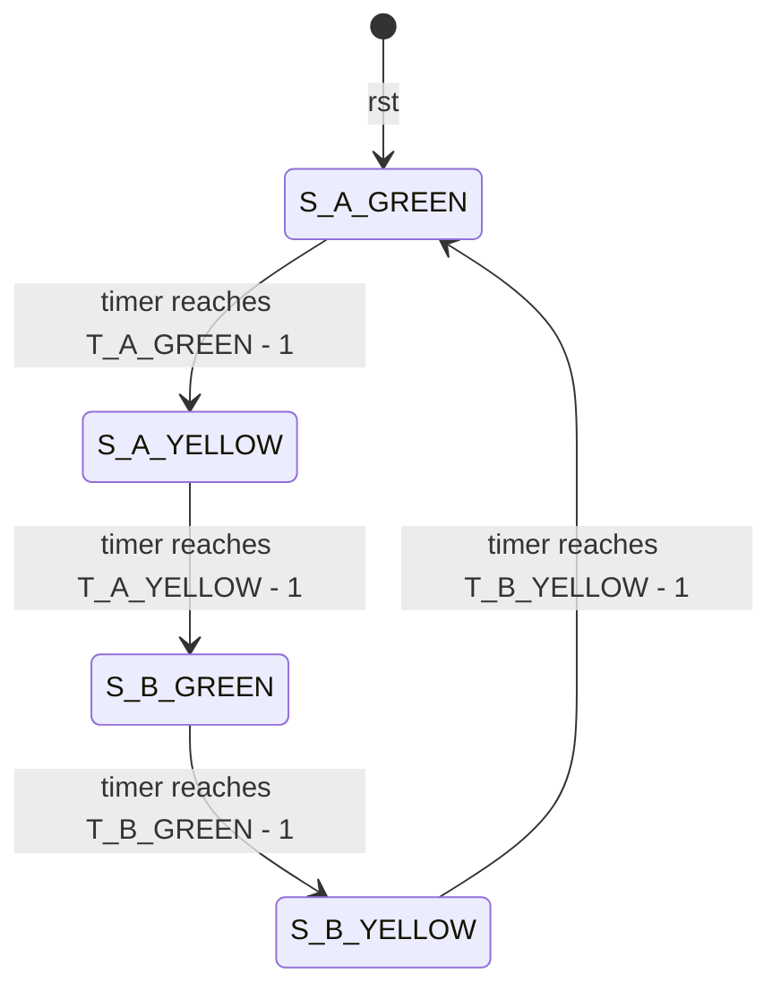

# Digital Traffic Light Controller (Verilog)

A synchronous Finite State Machine (FSM) that controls the traffic lights at a two-road intersection (**Road A** and **Road B**), written in Verilog HDL.

## Features

- 4-state Moore FSM that loops continuously
- Parameterised timing (green and yellow durations can be changed without editing the logic)
- Active-high synchronous reset
- Safety guarantee: both roads are never green at the same time, and every green-to-red change passes through a yellow phase
- Self-checking testbench with a mid-run reset test

## How It Works

On startup or reset, the controller goes to **State 1** (Road A green, Road B red) and clears its internal timer. A counter increments on every rising clock edge to measure how long the current state has lasted. When the count reaches the state's duration, the FSM moves to the next state and the counter restarts.

| State | Road A | Road B | Duration |
| :--- | :--- | :--- | :--- |
| 1 (`S_A_GREEN`)  | Green  | Red    | 10 s |
| 2 (`S_A_YELLOW`) | Yellow | Red    | 3 s  |
| 3 (`S_B_GREEN`)  | Red    | Green  | 10 s |
| 4 (`S_B_YELLOW`) | Red    | Yellow | 3 s  |

One full cycle takes 10 + 3 + 10 + 3 = **26 clock cycles**. With the 1 Hz logical clock used in simulation (1 cycle = 1 second), that is 26 seconds.

### State Diagram



## Interface

| Signal | Direction | Width | Description |
| :--- | :--- | :--- | :--- |
| `clk` | Input | 1 | System clock (1 Hz logical clock in simulation) |
| `rst` | Input | 1 | Active-high synchronous reset |
| `road_a` | Output | 3 | Road A lights: `[2]` Red, `[1]` Yellow, `[0]` Green |
| `road_b` | Output | 3 | Road B lights: `[2]` Red, `[1]` Yellow, `[0]` Green |

Outputs are one-hot encoded, so only one light is on per road at any time:

- `3'b100` = Red
- `3'b010` = Yellow
- `3'b001` = Green

### Parameters

| Parameter | Default | Meaning |
| :--- | :--- | :--- |
| `T_A_GREEN`  | 10 | Road A green duration (clock cycles) |
| `T_A_YELLOW` | 3  | Road A yellow duration |
| `T_B_GREEN`  | 10 | Road B green duration |
| `T_B_YELLOW` | 3  | Road B yellow duration |

## Timing Approach

Hardware only sees clock edges, so time is measured by counting cycles:

```
Number of clock cycles = Desired time (s) x Clock frequency (Hz)
```

In simulation we use a scaled **1 Hz logical clock**, so 1 clock cycle = 1 second. Simulating a real 50 MHz clock would need 50,000,000 cycles per second, which is slow and makes unreadable waveforms. On real FPGA hardware, a clock divider would first produce a 1-second tick from the board clock, and the state timer would count those ticks.

## Repository Structure

```
.
├── traffic_light_controller.v   # FSM design module
├── traffic_light_tb.v           # Self-checking testbench
├── docs/                        # State diagram and other documentation
└── README.md
```

> Adjust the file names above to match the actual files in this repo.

## Running the Simulation

Requires [Icarus Verilog](https://steveicarus.github.io/iverilog/) (and optionally GTKWave for viewing waveforms).

```bash
iverilog -o sim traffic_light_controller.v traffic_light_tb.v
vvp sim
```

A successful run prints `PASS: all checks passed.` at the end.

To view the waveform:

```bash
gtkwave traffic_light_tb.vcd
```

Add `clk`, `rst`, `road_a` and `road_b` to see the 10 s / 3 s / 10 s / 3 s pattern.

## What the Testbench Checks

- Correct light sequence over several full cycles, compared against a reference model
- Correct durations for every state
- Both roads are never green at the same time
- The FSM returns to State 1 when reset is applied in the middle of a cycle

## Branching Workflow

- `main` holds the stable, tested version
- Each contributor works on their own branch and opens a Pull Request to merge into `main` once their work is tested

## Contributors

- Agbara: FSM design and research
- Zipporah: testbench, state diagram and documentation

## References

1. Nandland, *State Machines in Verilog*: https://nandland.com/
2. HDLBits, *Sequential Logic and Counters*: https://hdlbits.01xz.net/wiki/Main_Page
3. Harris, D. M., & Harris, S. L. (2012). *Digital Design and Computer Architecture* (2nd ed.). Morgan Kaufmann. Chapter 3.
4. All About Circuits, *Digital Counters and Timing Circuits*: https://www.allaboutcircuits.com/textbook/digital/